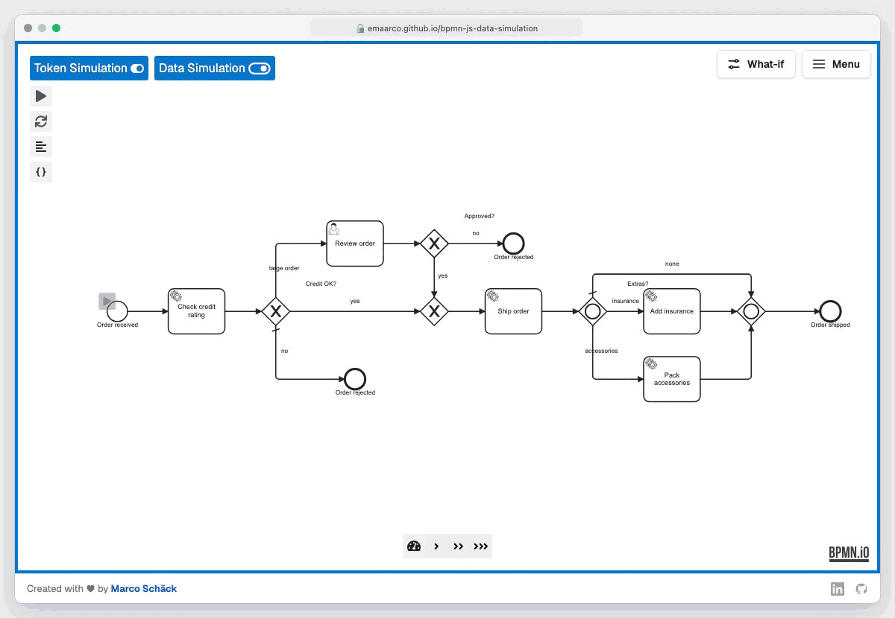

# bpmn-js-data-simulation

[](https://www.npmjs.com/package/@emaarco/bpmn-js-data-simulation)
[](https://github.com/emaarco/bpmn-js-data-simulation/actions/workflows/ci.yml)
[](LICENSE)

[](https://emaarco.github.io/bpmn-js-data-simulation/)

**Show which path a process takes for real data, right in bpmn-js.**

An add-on for the bpmn-js token simulation whose gateways decide by their conditions, the way Zeebe or Camunda 7 would. Pre-1.0: a minor release may still change the API.

## Why

Seeing the path a process takes for given data usually means deploying it. The token simulation needs no engine, but you click every gateway and it ignores conditions and mappings. This add-on evaluates them in the modeler, viewer or slide your readers see, within [known limits](docs/how-it-works.md#limits).

## What you get

- **See why a path is taken:** gateways that decided turn green, and a card lists each condition, its result and the values it read.
- **Show the path without running it:** `pathSimulation.simulate(variables)` marks the path the exclusive and inclusive gateways take, for example behind a slider, even in a plain viewer without the token simulation ([path simulation](docs/usage.md#path-simulation-what-if)).
- **Start from a scenario:** the token simulation's ▶ opens a dialog prefilled from a [scenario file](docs/scenarios.md) that also mocks task results.
- **Fail visibly:** if no flow matches or a condition fails, the token stops at a red gateway, like an incident.
- **Works in modelers and viewers:** one more module next to the token simulation.

## Supported engines

The `engine` option, `'zeebe'` by default, picks how conditions and mappings are read:

| Engine                         | `engine`     | Conditions                                 | Mappings              |
| ------------------------------ | ------------ | ------------------------------------------ | --------------------- |
| Zeebe (Camunda 8)              | `'zeebe'`    | FEEL                                       | `zeebe:ioMapping`     |
| Camunda 7, Operaton, CIB seven | `'camunda7'` | [JUEL subset](docs/engines.md#juel-subset) | `camunda:inputOutput` |

Conditions it cannot evaluate, such as JUEL method calls or scripts, fall back to a click and end the what-if path ([Engines](docs/engines.md)).

## Install

```bash
npm install @emaarco/bpmn-js-data-simulation bpmn-js-token-simulation zeebe-bpmn-moddle
```

It needs `bpmn-js` 18 or newer; for Camunda 7, install `camunda-bpmn-moddle` instead of `zeebe-bpmn-moddle`. The full simulation needs `bpmn-js-token-simulation` in your own dependencies, as above; it is an optional peer, so npm does not add it for you.

For the path alone (`PathSimulationModule`), leave the token simulation out:

```bash
npm install @emaarco/bpmn-js-data-simulation zeebe-bpmn-moddle
```

## Get started

1. Register the module next to the token simulation:

   ```ts
   import BpmnModeler from 'bpmn-js/lib/Modeler'
   import TokenSimulationModule from 'bpmn-js-token-simulation'
   import DataSimulationModule from '@emaarco/bpmn-js-data-simulation'
   import zeebeModdle from 'zeebe-bpmn-moddle/resources/zeebe.json'
   import 'bpmn-js-token-simulation/assets/css/bpmn-js-token-simulation.css'
   import '@emaarco/bpmn-js-data-simulation/assets/bpmn-js-data-simulation.css'

   const modeler = new BpmnModeler({
     container: '#canvas',
     additionalModules: [TokenSimulationModule, DataSimulationModule],
     moddleExtensions: { zeebe: zeebeModdle },
     dataSimulation: { engine: 'zeebe' },
   })
   ```

   For a viewer or Camunda 7, swap the imports as in [Usage](docs/usage.md#set-up-the-modeler).

2. Turn on the **Token Simulation** switch at the top left and press ▶ on a start event.
3. Fill in the variables, start, and hover a gateway to see why it decided.

From code, `modeler.get('pathSimulation').simulate({ orderTotal: 6800 })` marks the path instead; a viewer with only `PathSimulationModule` does the same without the token simulation. Full walk-through: [Usage](docs/usage.md).

## Help and feedback

- **Documentation:** [Usage](docs/usage.md), [Scenarios](docs/scenarios.md), [Engines](docs/engines.md) and [How it works](docs/how-it-works.md).
- **Demo:** [emaarco.github.io/bpmn-js-data-simulation](https://emaarco.github.io/bpmn-js-data-simulation/).
- **Bugs and ideas:** [open an issue](https://github.com/emaarco/bpmn-js-data-simulation/issues).

## Contributing

Contributions are welcome; see [CONTRIBUTING.md](CONTRIBUTING.md).

## Credits

- [bpmn-js-token-simulation](https://github.com/bpmn-io/bpmn-js-token-simulation) by bpmn.io moves the tokens.
- [feelin](https://github.com/nikku/feelin) evaluates FEEL.

## License

[MIT](LICENSE) © Marco Schäck
